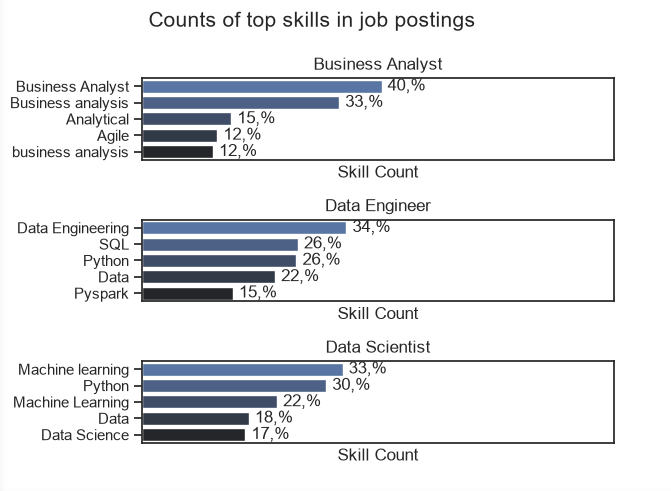

Welcome to my Data Analytics Project, where I am trying to help new data analysts find good job opportunities based on location, required skills, and the pay they want in this competitive job market. Things are changing daily in Data Analytics, and there is no single newsletter where they can easily find the jobs they want or the skills they need to improve to land the best role. I am trying to solve that problem with this project. :)

The data sourced from Luke Barousse's Python Course which provides a foundation for my analysis, containing detailed information on job titles, salaries, locations, and essential skills. 

These are the questions that make it hard for Data Analysts to find jobs, so I am working on answering them.

1.What are the skills most in demand for the top 3 most popular data roles?
2.How are in-demand skills trending for Data Analysts?
3.How well do jobs and skills pay for Data Analysts?
4.What are the optimal skills for data analysts to learn? (High Demand & High Paying)

This are the tools that, I used.

Python:  Python is backbone of this project.
Pandas Library: Pandas is used to analyze the data.
Matplotlib Library: Matplotlib heelped me to visualize my data.(Very helpful tool, makes data intresting to see!)
Seaborn Library: Helps me to build more advance visuals.
Visual Studio Code: I used this to run my Python scripts.

I started by importing the required libraries and cleaning the dataset.

# Importing Libraries
    import ast
    import pandas as pd
    import seaborn as sns
    from datasets import load_dataset
    import matplotlib.pyplot as plt  

# Loading Data
df = pd.read_csv('indian_tech_jobs_2026.csv')

# Data Cleanup
pattern = 'data|analyst|analytics|scientist|machine learning|ai'
data_retalted_titles = df[df['job_title'].str.contains(pattern, case=False, na=False)]

I filtered the top data for jobs in India.

1.What are the skills most in demand for the top 3 most popular data roles?

#CODE

fig, ax = plt.subplots(len(job_titles), 1)

sns.set_theme(style='ticks')

for i, job_title in enumerate(job_titles):
    df_plot = df_skills_perc[df_skills_perc['job_title'] == job_title].head(5) 
    sns.barplot(
        data=df_plot, 
        x='skill_percent',   # <-- use percentage column here
        y='skills_list', 
        ax=ax[i], 
        hue='skills_list', 
        palette='dark:b_r',
        legend=False
    )

    for n, v in enumerate(df_plot['skill_percent']):
        ax[i].text(v + 1, n, f'{v:.0f},%', va='center')

    ax[i].set_xticks([])
    ax[i].set_title(job_title)
    ax[i].set_ylabel('')
    ax[i].set_xlabel('Skill Count')
    ax[i].set_xlim(0, 78)
fig.suptitle('Counts of top skills in job postings', fontsize=15)
plt.tight_layout()
plt.show()

## Skills in Demand

This bar graph shows the top data roles and the skills required for each position.

According to the data, Business Analyst, Data Engineer, and Data Scientist are currently the most trending and in-demand roles.

Key Insights:

Business Analyst:Top priority is understanding business processes and gathering project requirements (mentioned in 33%–40% of jobs).  Analytical thinking (15%) and knowing Agile workflows (12%) are also common expectations. 

Data Engineer:SQL (26%) and Python (26%) are the most critical tools, appearing in about 1 out of every 4 job posts. Big data tools like PySpark (15%) are important for handling large amounts of data. 
 
Data Scientist:Machine Learning is the most required skill, appearing in about a third of all postings (~33%). Python (30%) is the essential coding language for building models and analyzing data.

View my notebook with detailed steps here: [2_skills_in_demand.ipynb](1_Basics\3_project\2_skills_in_demand.ipynb)