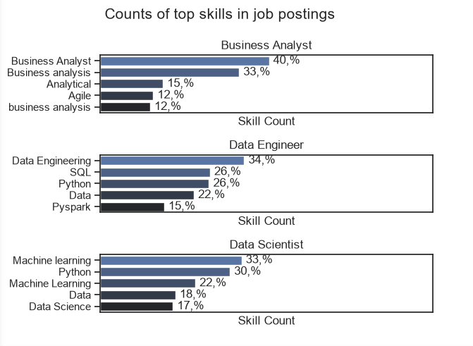
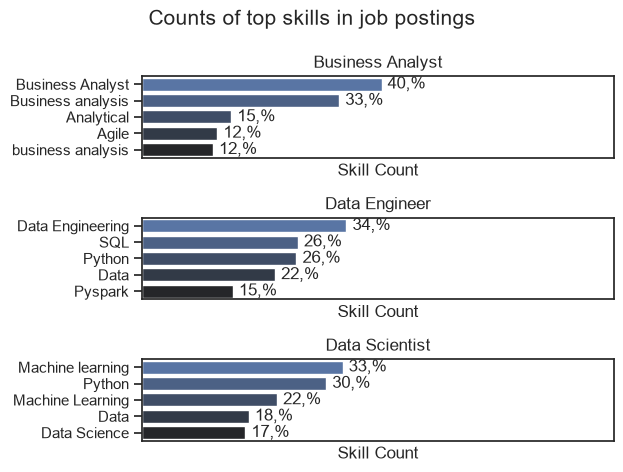
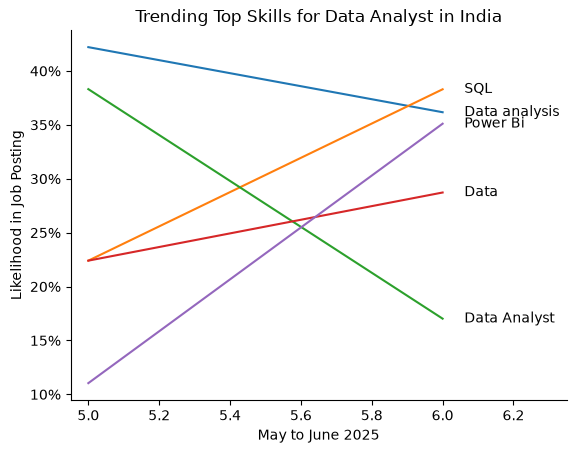
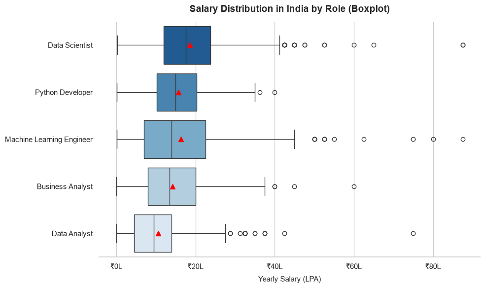
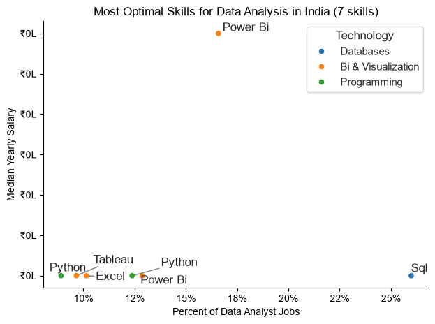

Welcome to my Data Analytics Project, where I am trying to help new data analysts find good job opportunities based on location, required skills, and the pay they want in this competitive job market. Things are changing daily in Data Analytics, and there is no single newsletter where they can easily find the jobs they want or the skills they need to improve to land the best role. I am trying to solve that problem with this project. :)

The data sourced from  Kaggle which provides a foundation for my analysis, containing detailed information on job titles, salaries, locations, and essential skills. 

These are the questions that make it hard for Data Analysts to find jobs, so I am working on answering them.

1.What are the skills most in demand for the top 3 most popular data roles?
2.How are in-demand skills trending for Data Analysts?
3.How well do jobs and skills pay for Data Analysts?
4.What are the optimal skills for data analysts to learn? (High Demand & High Paying)

This are the tools that, I used.

Python:  Python is backbone of this project.
Pandas Library: Pandas is used to analyze the data.
Matplotlib Library: Matplotlib heelped me to visualize my data.(Very helpful tool, makes data intresting to see!)
Seaborn Library: Helps me to build more advance visuals.
Visual Studio Code: I used this to run my Python scripts.

I started by importing the required libraries and cleaning the dataset.

# Importing Libraries
    import ast
    import pandas as pd
    import seaborn as sns
    from datasets import load_dataset
    import matplotlib.pyplot as plt  

# Loading Data
df = pd.read_csv('indian_tech_jobs_2026.csv')
The dataset used for this analysis spans from May to June 2025

# Data Cleanup
pattern = 'data|analyst|analytics|scientist|machine learning|ai'
data_retalted_titles = df[df['job_title'].str.contains(pattern, case=False, na=False)]

I filtered the top data for jobs in India.

1.What are the skills most in demand for the top 3 most popular data roles?

#CODE

fig, ax = plt.subplots(len(job_titles), 1)

sns.set_theme(style='ticks')

for i, job_title in enumerate(job_titles):
    df_plot = df_skills_perc[df_skills_perc['job_title'] == job_title].head(5) 
    sns.barplot(
        data=df_plot, 
        x='skill_percent',   # <-- use percentage column here
        y='skills_list', 
        ax=ax[i], 
        hue='skills_list', 
        palette='dark:b_r',
        legend=False
    )

    for n, v in enumerate(df_plot['skill_percent']):
        ax[i].text(v + 1, n, f'{v:.0f},%', va='center')

    ax[i].set_xticks([])
    ax[i].set_title(job_title)
    ax[i].set_ylabel('')
    ax[i].set_xlabel('Skill Count')
    ax[i].set_xlim(0, 78)
fig.suptitle('Counts of top skills in job postings', fontsize=15)
plt.tight_layout()
plt.show()

## Skills in Demand

This bar graph shows the top data roles and the skills required for each position.

According to the data, Business Analyst, Data Engineer, and Data Scientist are currently the most trending and in-demand roles.

Key Insights:

Business Analyst:Top priority is understanding business processes and gathering project requirements (mentioned in 33%–40% of jobs). Analytical thinking (15%) and knowing Agile workflows (12%) are also common expectations. 

Data Engineer:SQL (26%) and Python (26%) are the most critical tools, appearing in about 1 out of every 4 job posts. Big data tools like PySpark (15%) are important for handling large amounts of data. 
 
Data Scientist:Machine Learning is the most required skill, appearing in about a third of all postings (~33%). Python (30%) is the essential coding language for building models and analyzing data.

View my notebook with detailed steps here: [2_skills_in_demand.ipynb](2_skills_in_demand.ipynb)

2.How are in-demand skills trending for Data Analysts?

#CODE

df_plot = df_IND_DA_perc.iloc[:, :5]

sns.lineplot(data=df_plot, dashes=False, palette='tab10')
sns.despine()

plt.title('Trending Top Skills for Data Analyst in India')
plt.ylabel('Likelihood in Job Posting')
plt.xlabel('May to June 2025')
plt.legend().remove()

# 1. Indent the line inside the loop
# 2. Adjust x-position to sit right next to the last data point
last_x = len(df_plot) - 1 if isinstance(df_plot.index[0], str) else df_plot.index[-1]
x_pos = last_x + 0.05  # slightly to the right of the last point

for i in range(5):
    plt.text(x_pos, df_plot.iloc[-1, i], f" {df_plot.columns[i]}", va='center')

plt.xlim(right=x_pos + 0.3)  # Add padding so text doesn't get clipped
plt.show()

INSIGHTS

1] SQL is in high demand: It grew rapidly from 22% to over 38%, becoming the most requested skill by June.

2] Power BI saw the fastest growth: It jumped from just 11% up to 35%, showing that companies want analysts who can build dashboards.

3] Focus on real tools over job titles: Generic keywords like "Data Analyst" dropped sharply (from 38% down to 17%), while specific technical tools like SQL and Power BI took over.

4] The essential package: By June, having both SQL (for getting data) and Power BI (for visualizing data) became the main requirement for Data Analyst jobs in India.

3.How well do jobs and skills pay for Data Analysts?

#CODE

df_plot = df_IND_DA_perc.iloc[:, :5]

sns.lineplot(data=df_plot, dashes=False, palette='tab10')
sns.despine()

plt.title('Trending Top Skills for Data Analyst in India')
plt.ylabel('Likelihood in Job Posting')
plt.xlabel('May to June 2025')
plt.legend().remove()

last_x = len(df_plot) - 1 if isinstance(df_plot.index[0], str) else df_plot.index[-1]
x_pos = last_x + 0.05  

for i in range(5):
    plt.text(x_pos, df_plot.iloc[-1, i], f" {df_plot.columns[i]}", va='center')

plt.xlim(right=x_pos + 0.3) 
plt.show()

##INSIGHTS

1]Real tools took over fast: The most striking takeaway is how fast hard technical skills jumped. Power BI shot up from roughly 11% to 35%, and SQL climbed from 22% to over 38%. Companies clearly stopped asking for vague knowledge and started demanding hands-on querying and dashboard-building tools.  

2] Fluff keywords are disappearing: The term "Data Analyst" dropped sharply from ~38% down to 17%. Recruiters often paste the job title itself into the skills section when posting lazily; seeing this crash means job descriptions became much more specific about what the analyst will actually use rather than repeating the job title.  

3] "Data analysis" remains a steady baseline: While it dipped slightly from 42% down to 36%, broad analytical reasoning is still present in more than a third of all postings.  

4] The practical takeaway for a job seeker: If you are preparing for Data Analyst roles in India, having SQL + Power BI is essentially non-negotiable—they went from being "nice-to-haves" in May to the dominant requirements by June.

4.What are the optimal skills for data analysts to learn? (High Demand & High Paying)

#CODE

import matplotlib.pyplot as plt
import matplotlib.ticker as ticker
import seaborn as sns

df_clean = df[df['salary_midpoint_lpa'] > 0].dropna(subset=['salary_midpoint_lpa']).copy()

top_roles = df_clean['role_category'].value_counts().head(5).index
df_clean = df_clean[df_clean['role_category'].isin(top_roles)]

order = df_clean.groupby('role_category')['salary_midpoint_lpa'].median().sort_values(ascending=False).index

sns.set_theme(style="whitegrid")
fig, ax = plt.subplots(figsize=(10, 6))

sns.boxplot(
    data=df_clean,
    x='salary_midpoint_lpa',
    y='role_category',
    order=order,
    palette='Blues_r',
    showmeans=True,  
    meanprops={"marker": "^", "markerfacecolor": "red", "markeredgecolor": "red", "markersize": "7"},
    ax=ax
)

ax.set_title('Salary Distribution in India by Role (Boxplot)', fontsize=14, weight='bold', pad=14)
ax.set_xlabel('Yearly Salary (LPA)', fontsize=11, labelpad=8)
ax.set_ylabel('', fontsize=11)

ax.xaxis.set_major_formatter(ticker.FuncFormatter(lambda y, pos: f'₹{int(y)}L'))

sns.despine(left=True, bottom=False)
plt.tight_layout()
plt.show()

##INSIGHTS

1]Data Analyst is the entry gateway, but has the lowest ceiling:The median salary (the vertical line inside the box) sits right around ₹9L–₹10L, with the bulk of roles (the shaded box) landing tightly between ₹5L and ₹14L. It has the most compressed salary band among all data roles, making it the most accessible starting point, though regular postings rarely break past ₹25L–₹30L without entering outlier territory.  

2] Data Scientist holds the highest, most consistent pay floor:Data Scientist commands the highest median salary (~₹18L) and the highest baseline (25th percentile starts well above ₹11L). Unlike engineering roles that have wide swings depending on product tier, Data Science salaries stay consistently elevated across the middle 50% of the market. Machine Learning Engineer has the wildest variance:While its median (~₹14L) sits below Data Scientist, the box is much wider and stretches furthest to the right (up to the standard whisker near ₹45L). It also displays the most aggressive high-end outliers stretching all the way to ₹60L–₹85L+. This reflects a two-tier market: generic early-career roles at services firms versus specialized generative AI / deep tech engineers at MNCs/product startups pulling top-tier compensation.   

3]Python Developer vs Business Analyst:Python Developer has a remarkably tight middle band centered at ₹15L, showing predictable, standard software compensation with fewer extreme swings.  

4] Business Analyst clusters slightly lower (median around ₹13L–₹14L), sitting firmly between traditional analytics and core technical engineering. Means (red triangles) pulled above Medians:Across every single role, the red triangle (mean/average) is pulled noticeably to the right of the median line. This is classic right-skewed tech compensation: a handful of high-paying global GCCs, fintechs, and tech giants offer outsized compensation packages (₹40L–₹80L+) that inflate the statistical average compared to what typical job postings offer.

##4. What is the most optimal skills to learn for Data Analysis?

#CODE

import matplotlib.pyplot as plt
import seaborn as sns
from adjustText import adjust_text
from matplotlib.ticker import PercentFormatter

sns.scatterplot(
    data=df_plot, 
    x='skill_percent',
    y='median_salary',
    hue='technology'
)

Key takeaways

1] The Core "Must-Have" Trio (Power BI, SQL, Python):
Power BI (~30%), SQL (~28%), and Python (~21%) sit furthest to the right, 
making them the non-negotiable baseline for landing interviews. However, because these tools are required across 
entry- and mid-level openings, their median salaries cluster around ₹6.0L – ₹6.5L.   

2] The Cloud & Data Warehouse Multiplier (Snowflake, Databricks, PostgreSQL):
Skills in the Cloud & Big Data and specialized Databases categories appear in fewer than 3% of job postings, 
yet they command a massive compensation jump—clustering around ₹17.5L for Snowflake and Databricks, and reaching nearly ₹29L for PostgreSQL. Employers looking for analysts who can work directly inside modern cloud data warehouses pay significantly above the market average.   

3] Traditional & Analytical Supporting Tools (Excel, Tableau, Machine Learning, Statistics):
Excel (~12%) and Tableau (~13%) remain steady secondary requirements with median pay near ₹6.0L – ₹6.5L, 
while Statistics (~3%) and Machine Learning (~9%) sit at the lower end of the salary band (₹5.0L – ₹6.0L),
 often reflecting junior or generalist roles that list broad analytical buzzwords rather than specialized production 
 stacks.   

Career Takeaway-
If you are breaking into the market, SQL, Power BI, and Python give you the widest net of job opportunities. 
Once you have that foundation, adding modern cloud platforms like Snowflake or Databricks is the clearest lever to move from the ₹6L–₹7L bracket into ₹15L+ roles.   

